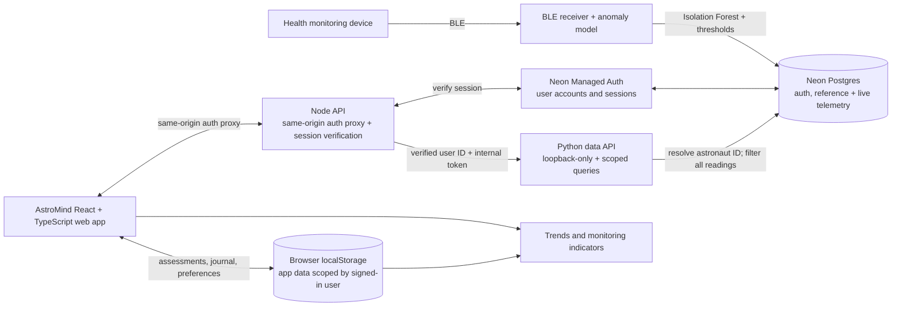
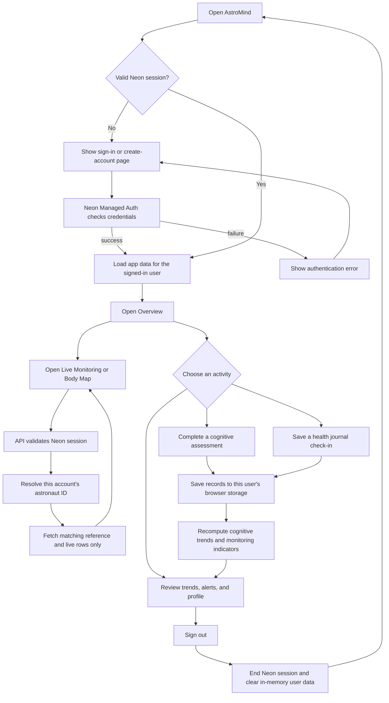

# AstroMind Architecture and Workflow

> AstroMind is a fictional-data monitoring prototype. BLE/model processing runs in the sibling `astronaut_health_ble` project; its live readings are synced to Neon and read by this web app.

## Architecture

### Responsibilities

- **Health monitoring devices and BLE receiver:** The sibling `astronaut_health_ble` project receives readings, runs `anomaly_model.py`, and syncs model output to Neon `health_telemetry`.
- **AstroMind web app:** React/Vite UI for cognitive assessments, health journal, trends, alerts, and profile.
- **Node API:** Proxies Neon Auth on the app origin and verifies the current session before forwarding its user ID to the loopback-only data API. The browser cannot choose an astronaut ID for data queries.
- **Python data API:** Uses the server-only Postgres connection to resolve `astronaut_web_accounts` and query only the mapped astronaut's readings. Its internal token is never exposed to the browser.
- **Neon Managed Auth:** Verifies email/password credentials and maintains user sessions in the Neon `neon_auth` schema.
- **Neon telemetry:** `astro_reference_telemetry` stores this app's model-scored CSV history; `health_telemetry` stores live receiver readings. The API returns only records matching the authenticated user's assigned astronaut ID.
- **Browser storage:** Stores the cognitive assessment, journal, preference, and seeded demo records under the authenticated Neon user. Those app records remain browser-local.
- **Monitoring indicators:** Computed in the app from assessment and journal history; they are not medical diagnoses.

## User workflow

## Data boundaries and current limitations

- Neon Auth owns identity and sessions. The browser never connects directly to Postgres with a database password.
- Assessment results, journal entries, preferences, and seeded demo history are currently stored in browser `localStorage`, scoped by Neon user ID. They are not yet synchronized to Neon and will not follow a user to another browser.
- Telemetry import and random account provisioning are explicit setup commands; the CSV is not transferred merely by building the UI.
- The monitoring API resolves the astronaut ID from a verified Neon session and a unique server-side mapping. It does not expose a caller-controlled astronaut filter.
- The BLE receiver syncs deferred readings every 60 seconds; the web UI polls Neon every five seconds, so updates may lag the receiver.
- All seeded readings and profile data are fictional. Monitoring indicators are informational only, not medical diagnoses.
