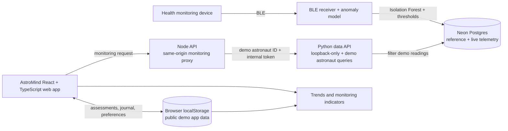
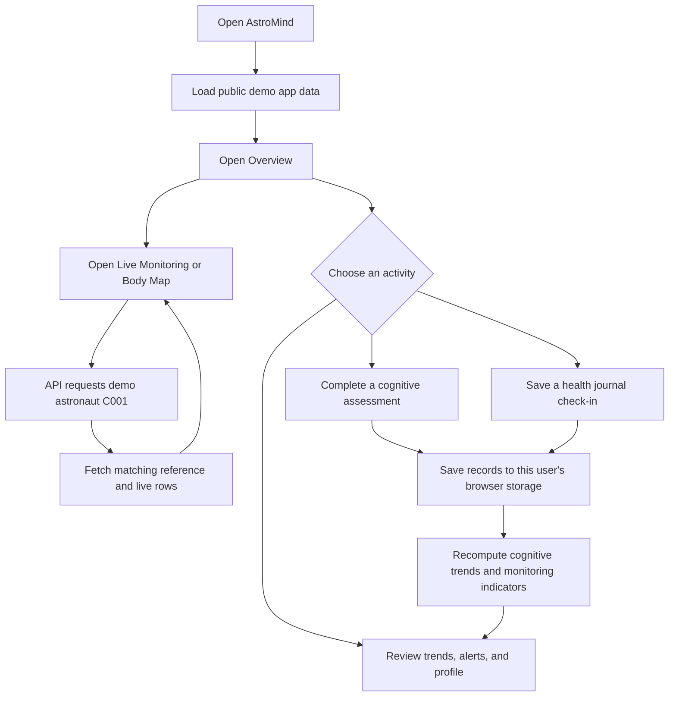

# AstroMind Architecture and Workflow

> AstroMind is a fictional-data monitoring prototype. BLE/model processing runs in the sibling `astronaut_health_ble` project; its live readings are synced to Neon and read by this web app.

## Architecture

### Responsibilities

- **Health monitoring devices and BLE receiver:** The sibling `astronaut_health_ble` project receives readings, runs `anomaly_model.py`, and syncs model output to Neon `health_telemetry`.
- **AstroMind web app:** React/Vite UI for cognitive assessments, health journal, trends, alerts, and profile.
- **Node API:** Proxies public monitoring requests to the loopback-only data API. It does not require user credentials.
- **Python data API:** Uses the server-only Postgres connection and defaults monitoring to demo astronaut `C001`. Its internal token is never exposed to the browser.
- **Neon telemetry:** `astro_reference_telemetry` stores this app's model-scored CSV history; `health_telemetry` stores live receiver readings.
- **Browser storage:** Stores cognitive assessment, journal, preference, and seeded demo records in browser local storage.
- **Monitoring indicators:** Computed in the app from assessment and journal history; they are not medical diagnoses.

## User workflow

## Data boundaries and current limitations

- The public demo does not authenticate users. The browser never connects directly to Postgres with a database password.
- Assessment results, journal entries, preferences, and seeded demo history are stored in browser `localStorage`. They are not synchronized to Neon and will not follow a user to another browser.
- Telemetry import is an explicit setup command; the CSV is not transferred merely by building the UI.
- The monitoring API defaults to C001 and can be evaluated without an account.
- The BLE receiver syncs deferred readings every 60 seconds; the web UI polls Neon every five seconds, so updates may lag the receiver.
- All seeded readings and profile data are fictional. Monitoring indicators are informational only, not medical diagnoses.
